# Perun Weather for Android

*Weather, made visible.*

Perun Weather is a weather app for Android built around charts. Instead of an icon and a handful of numbers, it shows how the forecast develops over time, so you can read the data yourself and judge what it means. It covers forecasts, weather alerts, air quality and pollen, sea data and weather maps, and it has no ads and no account.

It is the Android version of [Perun Weather for Linux and Windows](https://github.com/tothpsk/perun-weather), written in Kotlin with Jetpack Compose.

**Current version:** 1.3.0 (see the [changelog](CHANGELOG.md)) | **Requires:** Android 15 (API 35) or newer | **Languages:** Slovak, British English

## A tour of the app

### Now

The current conditions for the selected location: temperature and what it feels like, the most serious active alert, a summary of the day and a grid of tiles for precipitation, wind, cloud cover, UV, humidity, air pressure and more. You choose which tiles are shown and in what order. When rain is expected within the next hour, a precipitation nowcast appears, and when there are storm cells or lightning nearby, a storms card shows their distance and direction.

Swipe left or right to move between your saved locations. Every location can have its own weather model and alert sources. The list of saved locations marks every place that has an official alert.

A long press on the feels-like temperature opens a colour scale with its bands, from freezing to hot.

A long press on the app icon offers shortcuts to Now, Forecast, Maps and Alerts.

<p align="center">
  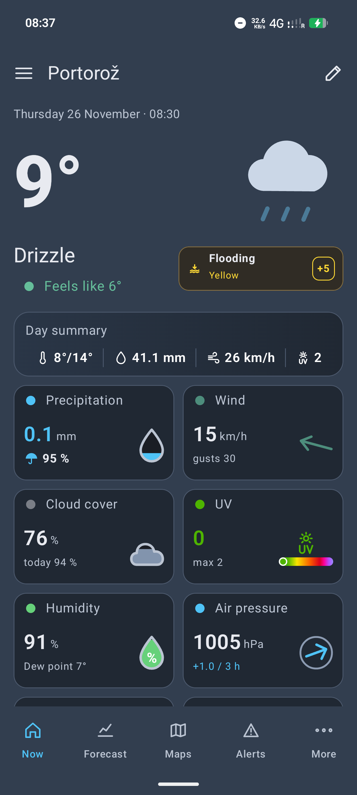
</p>

### Forecast

The forecast lists the coming days for one parameter at a time. The bar at the top switches between temperature, precipitation, wind, cloud cover, UV, humidity, visibility and others, and you can also swipe between them. Opening a day shows its hourly detail, with one row for every parameter and a cursor you can drag to read the values at a given time. Precipitation is drawn as bars, and a swipe over the name of the day opens the next or the previous day. At the cursor, precipitation is shown as snow depth for snow, as an amount for rain, and as both for rain with snow. The daily cloud cover is the median of the hours between sunrise and sunset.

<p align="center">
  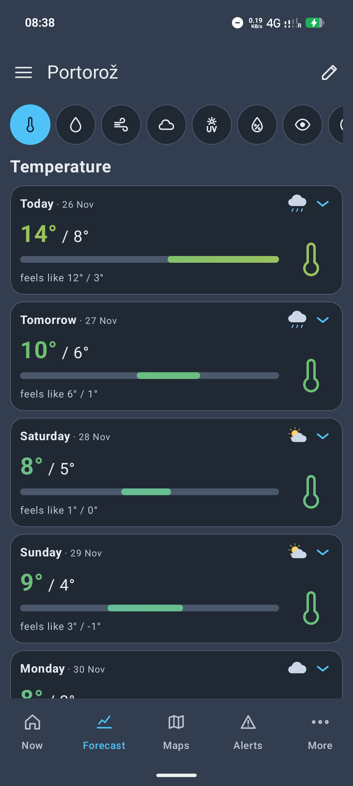
  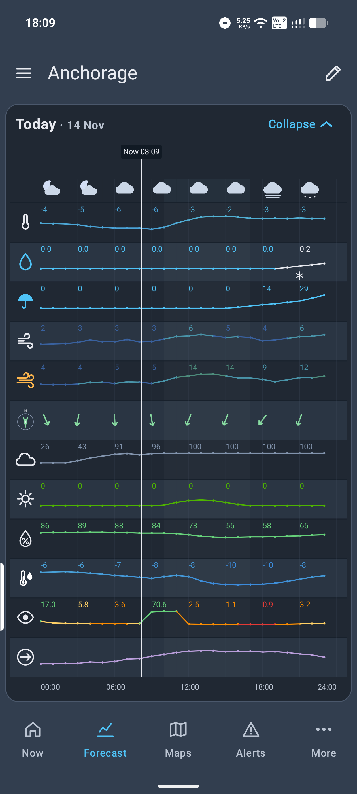
</p>

### Charts and uncertainty

The charts show several days at once. With the uncertainty band switched on, each curve shows the median of an ensemble forecast (P50) together with its range (percentiles P10 to P90 by default), so you can see how sure the forecast is, not only what it says. The touch cursor shows the values at the chosen time and the alerts active at that moment. The precipitation probability is the forecast of the model, without a band. When the selected weather model lacks a value, the app fills it in from the Best match model and says so.

<p align="center">
  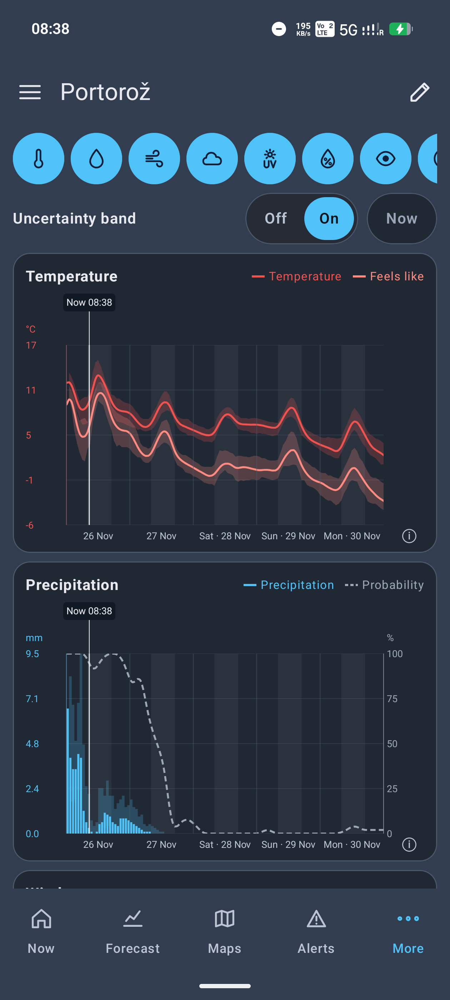
</p>

### Alerts

Active alerts are drawn on a timeline and listed with their severity, issuer and period of validity. Four independent sources can be combined freely, and each is shown under its own heading without merging duplicates:

- Local alerts computed in the app from the forecast.
- MeteoAlarm for Europe. A place gets the alerts of the warning areas it lies in, by its position.
- LibreWXR for the world.
- FOSS Public Alert Server for the world (meteorological alerts only).

The text of an alert is shown in the language of the issuing service; the app does not translate it.

<p align="center">
  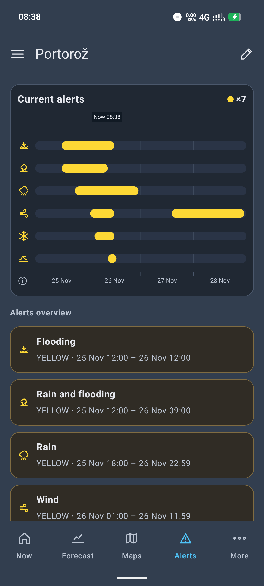
</p>

### Air quality and pollen

The air quality index on the European or the US scale, particulate matter, gases and pollen, with the same two views as the forecast: the coming days for one parameter, and the hourly detail of a day. A swipe over the header of the hourly detail opens the next or the previous day.

<p align="center">
  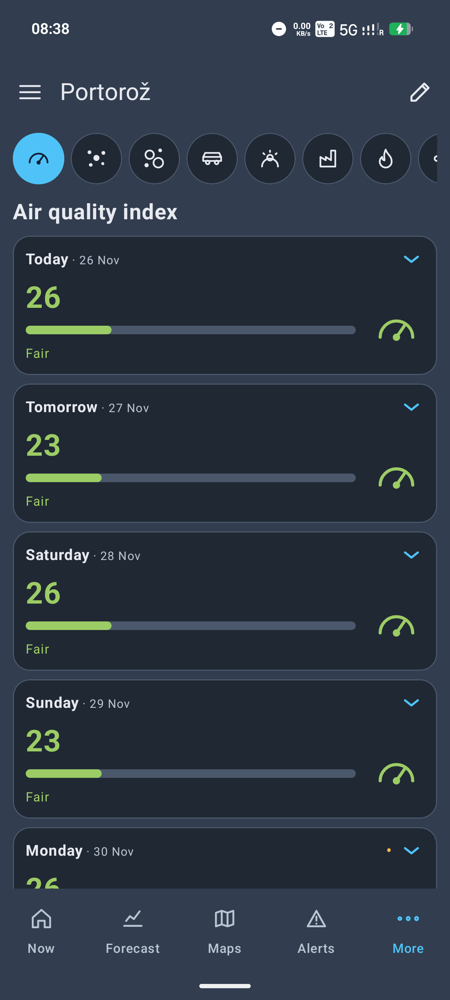
  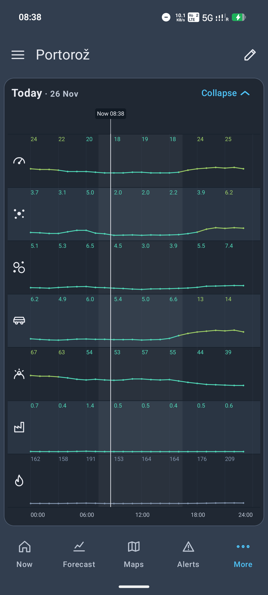
</p>

### Sea data

For places by the sea, charts of sea temperature, sea level and other marine data. The sea level chart marks the model maximum and minimum, and a tap on the legend hides or shows the markers. The section can be switched off when you do not need it.

<p align="center">
  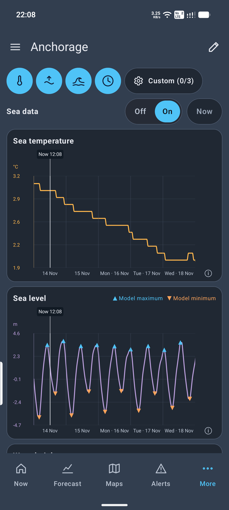
</p>

### Maps

A weather map with radar, including its short-term forecast, and other LibreWXR layers, with animation and a time slider. Maps supplement the forecast and official warnings; they do not replace them.

<p align="center">
  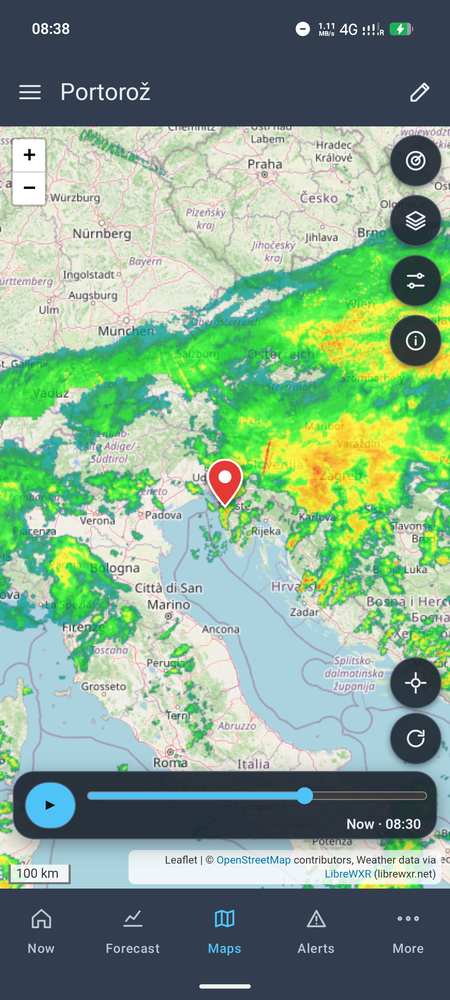
</p>

### Sun and Moon

Sunrise and sunset, the length of the day and its change, moonrise and moonset, the time the Moon is above the horizon and the phase of the Moon. A tap on a row explains its value in words.

<p align="center">
  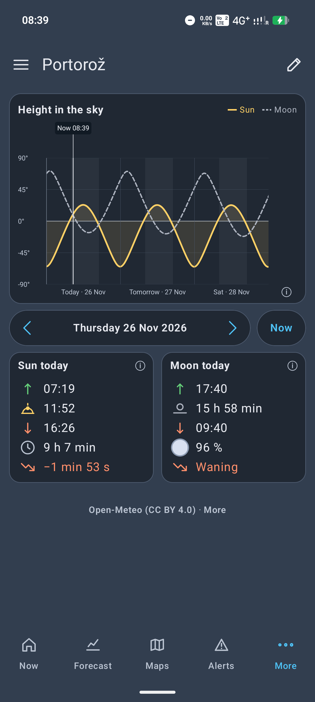
</p>

### Notifications

- Current conditions as a permanent notification, and a chosen value in the status bar.
- Weather alerts from a chosen severity, for the active location, all locations or a chosen set.
- Your own rules for a parameter and a threshold, for one or several locations.
- Summaries of today and tomorrow at a chosen hour.

### Widgets

Seven home-screen widgets are available, each with its own settings, which open from the home screen and from the Settings of the app:

- Compact: the current weather in one row.
- Next 6 hours: the current conditions and the coming hours.
- Meteogram: a chart of the coming days.
- Day by hours: the hours of one day as a chart. Arrows switch the day and a tap opens that day in Forecast.
- 6 days: the forecast by day.
- Air and pollen: the air quality index or the pollen, with pollutants or kinds of pollen at larger sizes.
- Sun and Moon: the Sun or the Moon, with more values at larger sizes.

The wind direction is an arrow that points to where the wind blows to: behind the wind speed in Compact, Next 6 hours and 6 days, and as a row above the chart in Meteogram. The pressure icon shows the trend of the pressure.

A widget that shows a place also shows the strongest official warning of the period it covers: the next 24 hours, the hours of its chart, the six days or the shown day. Local estimates stay in the app.

The widgets are new; their look and behaviour may still change.

### Settings

Background refresh with battery and network rules, language, units and the air quality scale, the choice of tiles, chart and forecast options, notifications, widgets, and backup and restore of the whole configuration.

<p align="center">
  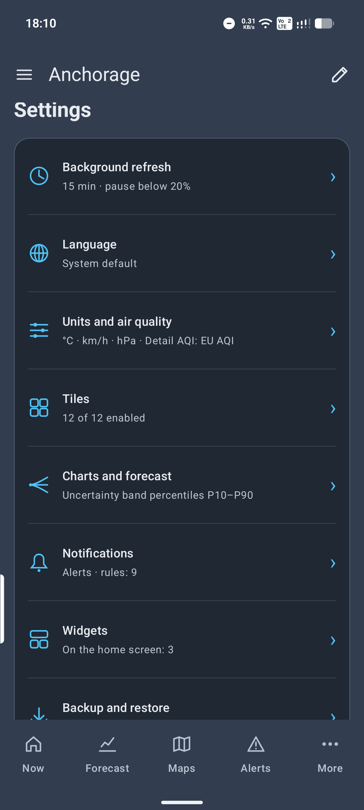
</p>

## Why another weather app

There are plenty of great weather apps for Android, so why make a new one? I had two reasons.

The first is that every app I tried was missing something I wanted, or it was full of ads.

The second is my family. They prefer mobile devices, and for them to be able to try Perun Weather at all, I had to bring it to Android. I did it with the help of vibe coding, using AI models from the Claude family.

This is a hobby project. I use and test it myself, but it may contain errors.

## About the name

Perun is the highest god of the early Medieval Slavic pantheon, the lord of the sky, thunder, lightning and storms. He was also associated with rain, fertility and the oak, and his symbols included fire, wind, mountains, the eagle and the thunder axe.

The name seemed fitting for an application that follows storms, rain and wind through the data. It refers only to the mythological figure and has no political or religious meaning.

*Source: [Perun on Wikipedia](https://en.wikipedia.org/wiki/Perun).*

## Perun Weather on the desktop

The original [Perun Weather](https://github.com/tothpsk/perun-weather) is a desktop application for Linux (Fedora and Debian packages) and Windows. The Android app follows its design and requirements, adapted to a phone.

## Install

1. Download `Perun-<version>.apk` from the [Releases](../../releases) page. The release also contains a `.sha256` file for checking the download.
2. Open the APK on the phone and allow installation from that source when Android asks.
3. To update, install the newer APK over the existing app. Your locations and settings are kept.

There is no preset location: on the first start the app asks you to add one, by search or from your current position.

The app is not on Google Play and does not update itself.

## Data sources

Perun Weather does not produce meteorological data. It fetches and visualises data from these services:

- [Open-Meteo](https://open-meteo.com/) (CC BY 4.0) for current weather, forecast, air quality and pollen (CAMS/Copernicus) and sea data.
- [LibreWXR](https://librewxr.net/) for the precipitation nowcast, storm cells, lightning, map layers and alerts.
- [MeteoAlarm](https://meteoalarm.org/) and the KDE [FOSS Public Alert Server](https://alerts.kde.org/) for alerts.

The full list with links is in the app under About, Data sources. Forecasts are model output and may contain errors; do not rely on the app as the only source for safety-critical decisions, and consult official warnings. To get the data, the app sends the coordinates of your saved locations to these services.

## Building

GitHub Actions builds the debug APK, runs unit tests and Android lint. The workflows use JDK 17, Gradle 8.9, Android SDK platform 35 and Build Tools 35.0.0. For a local build with these installed and the SDK configured:

```sh
gradle :app:assembleDebug :app:testDebugUnitTest :app:lintDebug
```

## Feedback

Bug reports and ideas are welcome in [Issues](../../issues). This is a hobby project, so replies may take a while.

## License

MIT, see [LICENSE](LICENSE). Data from third-party providers remains under the terms of those providers.
